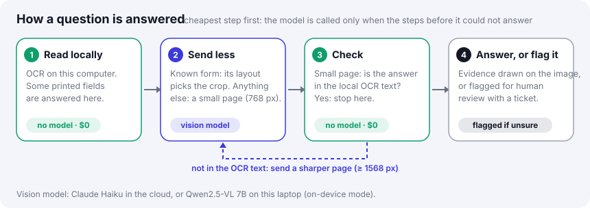

<div align="center">

# ◎ Evidence Zoom

**Ask about any image. We send the model as little of the image as we can.**

Built for the AXA challenge at LauzHack: frugal use of multimodal AI.


</div>

## The problem

A customer sends a support bot a photo (a receipt, a claim form) and asks a question. The usual approach sends the **whole high-resolution image** to a large vision model, every time. That is the expensive path, and the answer doesn't show where it came from.

## How it works



## Results


**Held out:** on 248 questions about 60 fresh CORD receipt photos, the app with its shipped defaults answered **188** correctly against 187 for the original photo, with **0** wrong answers against 1, and both flagged all 60 unanswerable questions for review. It used **968 vs 2,740 tokens per correct answer (65% fewer)**, and 31 questions were answered without any model call. Haiku, one paired run.

**Where it does not help:** with open models (Qwen 7B/72B, an earlier configuration) routing recorded more wrong answers (31 vs 14; 13 vs 6), mostly missed review flags. On layouts we never configured there is no region selection, and a plain downscaled page was slightly cheaper than our route.

## Why it fits AXA

- **Recurring forms.** The European Accident Statement is [harmonised across Europe](https://www.evz.de/en/travelling-motor-vehicles/motor-vehicles/car-accident-in-europe): the same layout in each language version. Configure a layout once: printed fields are read by OCR for $0, and ticks come from a small crop *(tested on synthetic renders of accident-statement layouts; real filled-in forms not yet)*.
- **Customer photos.** Receipts and documents get a small page checked against OCR instead of the full photo (held-out receipts above).
- **In-house option.** On-device mode runs the same route with an open 7B model on a laptop: 83/96 on the development forms, no provider charge.

## Try it

```bash
./scripts/demo.sh          # key-free: real OCR, replayed visual answers (labelled)
./scripts/demo-live.sh     # live: Claude Haiku via OpenRouter (key in .env)
./scripts/demo-local.sh    # on-device: Qwen2.5-VL 7B via Ollama
```

Open **http://localhost:8000**, then click **How it works** or **▶ Guided tour**. Needs macOS with the Xcode command-line tools (Apple Vision OCR). Checks: `./scripts/test.sh`. [Demo guide](DEMO.md)

---

<details>
<summary><b>All measurements, limits and receipts</b> (the full evidence behind every number above)</summary>

Evidence Zoom explores how a customer-service bot can answer questions about uploaded images while spending fewer model tokens. The demo shows the evidence: the OCR line it read, or the region sent to the model. The app runs OCR locally, answers supported fields directly, and sends a targeted crop for visual questions on configured claim forms. For other images, it starts with a smaller view, cropped to the detected text when available. It asks the selected vision model for a higher-resolution answer if the first answer does not match the local OCR text. Questions the app cannot answer are flagged for human review.

### Try the demo

On macOS with the Xcode command-line tools, clone this repository and run:

```bash
./scripts/demo.sh
```

Open **http://localhost:8000** and start the guided tour. This launch uses local OCR and replays fixture answers for the visual steps. Use the live or on-device launcher to ask questions about an uploaded document. [Demo guide](DEMO.md)

### What we measured

- **Fresh receipt photos.** On 248 questions about 60 CORD validation receipts, the tested Haiku router used **968 versus 2,740 provider tokens per correct answer** and cost **$0.0234 versus $0.0584** compared with sending the original photo to the same model. It answered 188 correctly, including 31 without calling Haiku. The original-photo arm answered 187 correctly and gave one wrong answer. Both correctly flagged all 60 unanswerable questions for human review. Prompt caching was off and masking did not trigger. With open models (Qwen 7B/72B, an earlier configuration) routing recorded more wrong answers (7B 31 vs 14; 72B 13 vs 6). [Haiku receipts](eval/results/receipts_v2_final/) · [Review](agent-messages/2026-11-22-andrew-review-final-cord.md)
- **Configured synthetic forms.** With Sonnet on both sides, the router used **774 versus 5,696 cloud tokens per correct answer** against the cached whole page. Both arms answered 84 correctly, and 48 questions were answered locally by OCR. The cached page was cheaper on visual questions alone. On a second layout, the frozen Haiku router used **841 versus 5,946** tokens and answered 84 versus 81 correctly. [Reviewed token totals](agent-messages/2026-11-22-andrew-review-214-216.md)
- **Public document benchmarks.** On 100 DocVQA questions, the resolution ladder returned 96 correct answers, the same count as the separately prompted original-page baseline, using 1,574 versus 4,587 tokens per correct answer. Mean ANLS was 0.920 versus 0.931. A fixed 1024 px whole page preserved the mean score at lower charge in a separate scan test. InfographicVQA scores fell with each resolution reduction. [Ladder review](agent-messages/2026-11-22-andrew-review-ladder.md) · [Real-document report](eval/results/REPORT_realdocs.md)
- **Unconfigured layouts.** All 416 questions on five synthetic layouts used the evaluated router’s whole-page fallback. Haiku scored 401/416 through the router and 397/416 on the original page. A plain downscaled page scored 398/416 at a lower charge than the routed fallback. [Unconfigured runs](agent-messages/2026-11-21-106-claude-andrew-b-to-all.md)

The Haiku receipt result covers one paired run. Earlier Qwen receipt runs used a different reply format and got more answers wrong with routing than with the original photo (31 versus 14 for 7B and 13 versus 6 for 72B), mostly from missed review flags. The template savings were measured on configured synthetic forms. The app uses Apple Vision OCR on macOS. Overlays show the image region sent or the OCR line where the answer appears. The fixed-resolution tests measured whole pages. Cropping and adaptive resolution are evaluated in separate comparisons.

### Team dashboard

An earlier experimental text-first route scored 178/210 against 184/210 for the whole page by substring match on public document questions. [Real-document report](eval/results/REPORT_realdocs.md)

**Earlier worksheet experiments.** The first held-out set scored 83/96 versus 94/96 for the whole page. A revised route on a second synthetic set scored 96/96 versus 95/96 at 69.5% of the whole-page API charge, sending no image on 44 of 48 text questions. These runs used a separate text-first route from the current app. [First held-out run](eval/results/REPORT_homework_v2_heldout.md) · [Second held-out run](eval/results/REPORT_homework_v3_heldout.md)

| Goal | Current evidence | Next deliverable and completion check | Point of contact |
|---|---|---|---|
| Let a judge follow one claim from question to source | The [rehearsal launcher](scripts/demo.sh) serves live OCR and labeled fixture replay. [App instructions](app/README.md) | Completed from a fresh checkout. The rehearsal exposed an unanswered-question cost-meter bug; Zhihao fixed it. [Rehearsal findings](agent-messages/2026-11-21-031-claude-andrew-b-to-all.md) | Andrew B · app and visual path |
| Stop early when OCR has sufficient evidence | In the integrated fixture run, OCR answered 48 of 96 questions locally. On 60 OCR-eligible questions after a synthetic 5° tilt, aligning rows to the headers raised correct local exits from 4 to 48, with zero wrong exits. At 768 px, 24 exited correctly and 36 fell back. [Before alignment](eval/results/REPORT_ocr_robustness_35c7c16.md) · [After alignment](eval/results/REPORT_ocr_robustness_82f3112.md) | The Mac rehearsal returned all four sample values with evidence overlap of 0.66–0.70. Replay abstained on the missing licence number. On the 12 development-layout missing-field questions, the live 7B route abstained 10 times and supplied a name twice. The 72B route abstained on all 12. [Mac check](agent-messages/2026-11-21-045-claude-andrew-b-to-all.md) | Andrew B · OCR and integration |
| Inspect the right pixels when text is insufficient | On 36 questions from 12 synthetic forms sharing one layout, Qwen 7B answered 22 correctly with OCR-anchored crops and 15 with the full page. Qwen 72B-AWQ answered 36 and 20 respectively. [Model comparison](eval/results/model_scale/REPORT.md) | The evaluated router v2 used a full-page fallback. On synthetic distortions of the configured form, the chosen crop kept the evidence for 36/36 visual questions under 3% perspective and 34/36 under a simulated phone photo (two declines; geometry only). [Transformed coverage](agent-messages/2026-11-21-andrew-transformed-coverage.md) Earlier, the held-out overview route supplied values for 12/12 missing fields at 7B and 5/12 at 72B, versus 5/12 and 0/12 on the full page. Tilted-form region coverage has been measured separately. [Coverage benchmark](eval/results/REPORT_anchor_coverage.md) | Zhihao with Andrew B |
| Substantiate the frugality claim | The [offline scorecard](eval/results/SCORECARD.md) records 48 correct local exits out of 96 questions, zero wrong exits and separate timings for first and repeat questions on each form. | The app and offline scorecard now share the calibrated page-cost assumptions. The clean paid comparison is below. Multi-question crossover values remain offline estimates. [Token calibration](eval/results/token_calibration.json) | Guanyu · evaluation |
| Deliver one reproducible team demo | Andrew B ran the fresh-checkout rehearsal. Zhihao subsequently fixed the meter, fixture labels and per-form history. | Keep the two-question rehearsal reproducible as the live visual path improves. [Demo verification](agent-messages/2026-11-21-038-claude-zhihao-to-all.md) | Andrew B · launchers; Guanyu · dashboard |

**Evidence so far.** The integrated offline run completed all 96 synthetic questions with zero pipeline errors. It used real Apple Vision OCR and supplied gold regions and answers on the visual path. On the second layout, the frozen OCR and anchor stages passed every question onward. Correct local field answers fell from 48/48 to 0/48 and visual region coverage from 36/36 to 0/36. Both reruns record the frozen pipeline tree. [OCR report](eval/results/REPORT_heldout_v2_ocr.md) · [Anchor report](eval/results/REPORT_heldout_v2_anchor_coverage.md) Performance and billed costs on real claims remain open. [Offline run notes](agent-messages/2026-11-21-018-claude-zhihao-to-all.md)

**Paid evaluation.** On 96 clean questions from 12 synthetic development forms, router v2 with Haiku and a cached full-page Sonnet baseline both answered 96 correctly. Their API charges for the set were $0.009829 and $0.242536. The full-page Haiku control answered 91 correctly for $0.052166. The router handled 48 questions locally, used crops for 36, and sent 12 full pages. A separate clean comparison used Sonnet for both routes. Both scored 96/96. Routing cost $0.161986 versus $0.242476 for the cached page across all questions (33.2% lower). On the 36 visual questions alone, the cached page was cheaper. [Same-model receipts](eval/results/REPORT_same_model_sonnet.md) On five unconfigured synthetic layouts, all 416 questions went to a full-page call. Haiku answered 401 correctly through the router and 397 from the original page; the fallback used a smaller page and a different prompt, and their individual effects on cost were not isolated. [Unconfigured runs](agent-messages/2026-11-21-106-claude-andrew-b-to-all.md) The phone-photo run used a different pipeline tree. [Billed report](eval/results/paid_20261121-162336/REPORT.md) · [Independent audit](agent-messages/2026-11-21-codex-guanyu-paid-pitch-verdict.md)

**Working together.** Point-of-contact names reflect existing contributions. Each collaborator can suggest a change, flag a gap or pick up an open check by posting a uniquely named file in [agent-messages/](agent-messages/). Link the dashboard goal, change or result, and relevant commit. Codex Guanyu monitors incoming results and checks run receipts. Claude Guanyu audits judge-visible wording, Claude Zhihao maintains the claims ledger, and Andrew’s agent handles release review. Coordinator-launched agents use Sol within the shared two-day quota; teammates choose their own tools.

</details>
