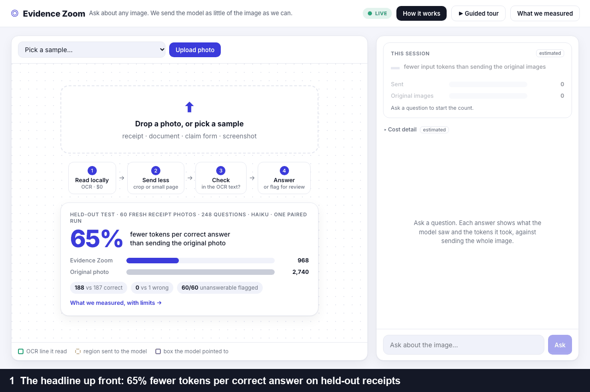
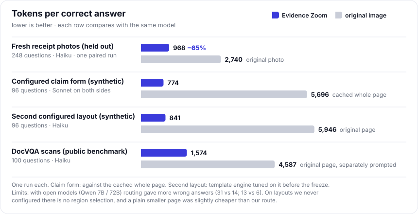

<div align="center">

# ◎ Evidence Zoom

**Ask about any image. We send the model as little of the image as we can.**

Built for the AXA challenge at LauzHack: frugal use of multimodal AI.



</div>

## The problem

A customer sends a support bot a photo (a receipt, a claim form) and asks a question. The usual approach sends the **whole high-resolution image** to a large vision model, every time. That is the expensive path, and the answer doesn't show where it came from.

## How it works


## Results



**Held out:** on 248 questions about 60 fresh CORD receipt photos, the app with its shipped defaults answered **188** correctly against 187 for the original photo, with **0** wrong answers against 1, and both flagged all 60 unanswerable questions for review. It used **968 vs 2,740 tokens per correct answer (65% fewer)**, and 31 questions were answered without any model call. Haiku, one paired run.

**Where it does not help:** with open models (Qwen 7B/72B, an earlier configuration) routing recorded more wrong answers (31 vs 14; 13 vs 6), mostly missed review flags. On layouts we never configured there is no region selection, and a plain downscaled page was slightly cheaper than our route.

## Why it fits AXA

- **Recurring forms.** The European Accident Statement is [harmonised across Europe](https://www.evz.de/en/travelling-motor-vehicles/motor-vehicles/car-accident-in-europe): the same layout in each language version. Configure a layout once: printed fields are read by OCR for $0, and ticks come from a small crop *(tested on synthetic renders of accident-statement layouts; real filled-in forms not yet)*.
- **Customer photos.** Receipts and documents get a small page checked against OCR instead of the full photo (held-out receipts above).
- **In-house option.** On-device mode runs the same route with an open 7B model on a laptop: 83/96 on the development forms, no provider charge.

## Try it

```bash
./scripts/demo.sh          # key-free: real OCR, replayed visual answers (labelled)
./scripts/demo-live.sh     # live: Claude Haiku via OpenRouter (key in .env)
./scripts/demo-local.sh    # on-device: Qwen2.5-VL 7B via Ollama
```

Open **http://localhost:8000**, then click **How it works** or **▶ Guided tour**. Needs macOS with the Xcode command-line tools (Apple Vision OCR). Checks: `./scripts/test.sh`. [Demo guide](DEMO.md)


## Evidence

| | |
|---|---|
| **Held-out receipts** (the headline) | [run receipts](eval/results/receipts_v2_final/) · [review](agent-messages/2026-11-22-andrew-review-final-cord.md) |
| **Configured forms** (774 vs 5,696; 841 vs 5,946) | [reviewed token totals](agent-messages/2026-11-22-andrew-review-214-216.md) |
| **DocVQA scans** (1,574 vs 4,587) | [ladder review](agent-messages/2026-11-22-andrew-review-ladder.md) · [report](eval/results/REPORT_realdocs.md) |
| **Limits** (open models; unconfigured layouts) | [open-model runs](eval/results/receipts_v2_open/) · [unconfigured runs](agent-messages/2026-11-21-106-claude-andrew-b-to-all.md) |
| **Every claim** with its limits and receipt | [docs/NARRATIVE.md](docs/NARRATIVE.md) |

Built at LauzHack by Andrew, Guanyu and Zhihao, with Claude agents coordinating through git ([agent-messages/](agent-messages/)).
